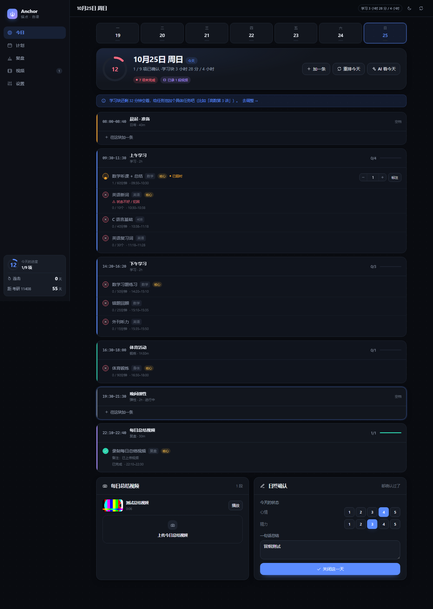
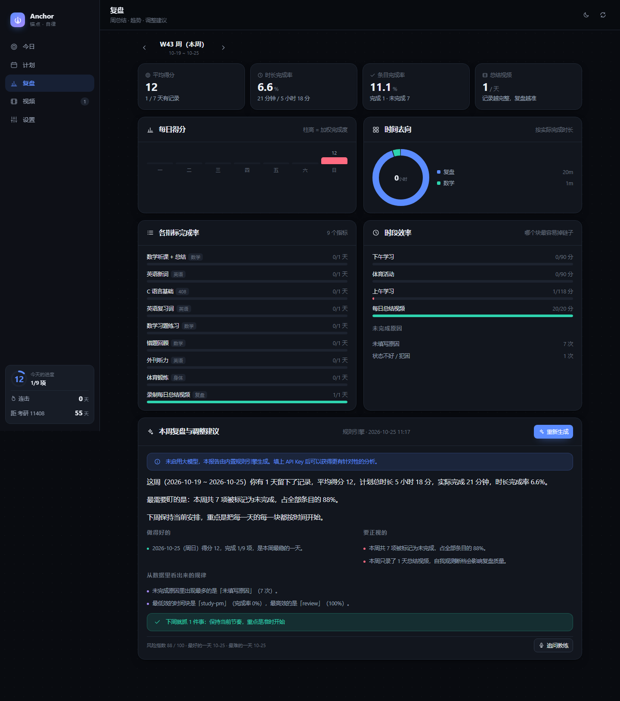
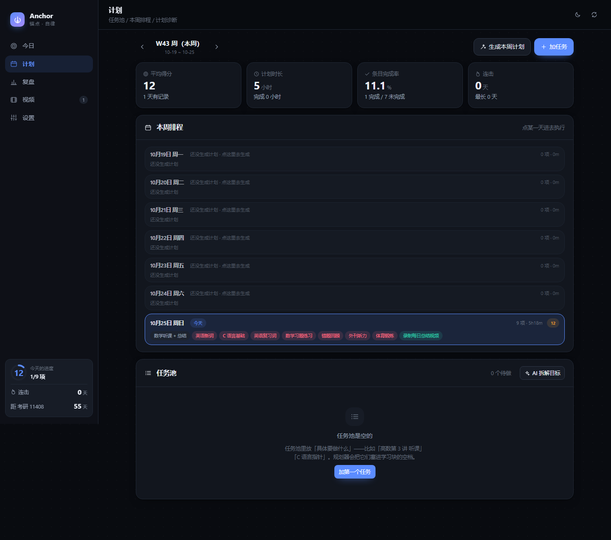
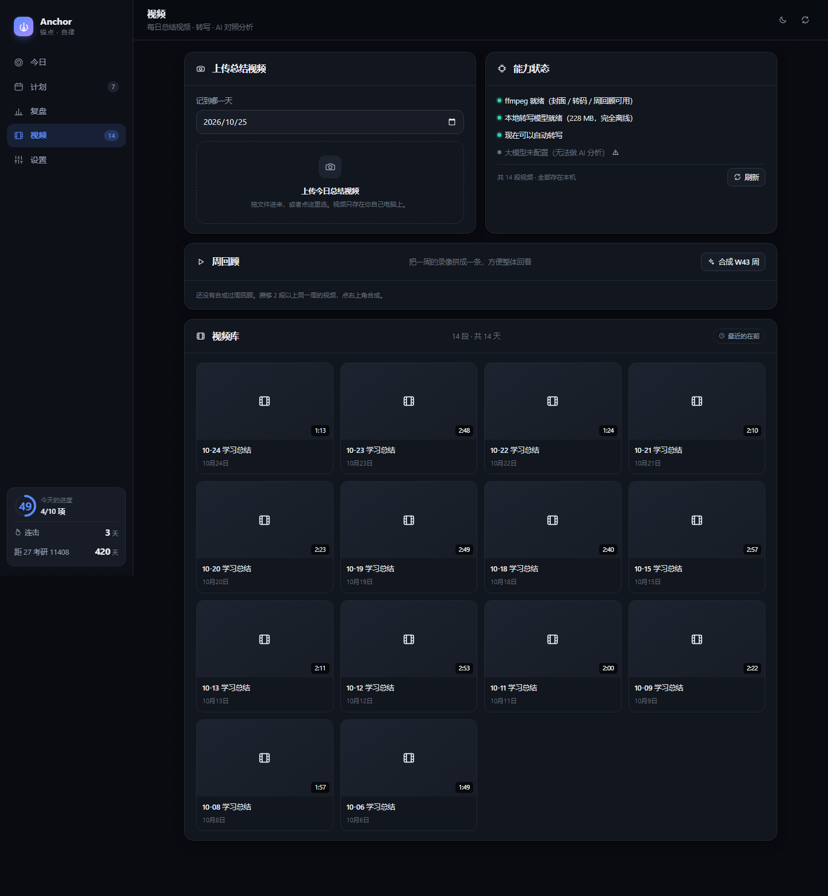
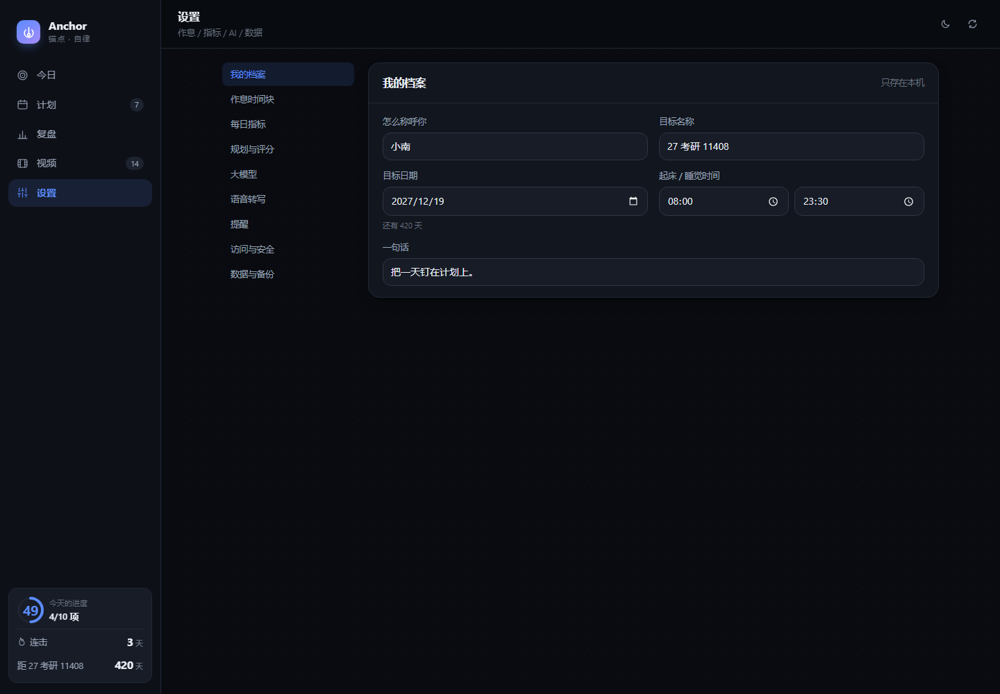
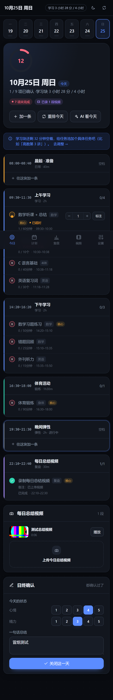

# Anchor · 锚点

**一个跑在你自己电脑上的自律监督系统。**
给它你的作息和每天必须做完的事，它把一天排好、盯着你打卡、把没做的标记出来，然后每周给你一份带数字的复盘和下一周该怎么调的结论。

> 不注册、不上云、不需要网络。数据（包括你录的总结视频）全部留在这台机器上。

```
08:00–08:40  晨起准备
09:30–11:30  上午学习   ├ 数学听课 + 总结   09:30–10:30
                        ├ 英语新词          10:30–10:38
                        ├ C 语言基础        10:38–11:18
                        └ 英语复习词        11:18–11:28
14:20–16:20  下午学习   ├ 数学习题练习      14:20–15:10
                        ├ 错题回顾          15:10–15:35
                        └ 外刊听力          15:35–15:50
16:30–18:00  体育活动
19:30–21:30  晚间弹性
22:10–22:40  录制每日总结视频
```

---

## 它到底解决什么问题

大部分打卡 App 只做「记」，不做「判」。它们不会告诉你：

- 你计划的 4 小时学习，在时间块上其实只装得下 3 小时 20 分；
- 「数学习题」这周出现 5 天，只完成 2 天，完成率 40%，而这个目标本身就不可能完成；
- 你下午那个块连续两周完成率低于 60%，而上午是 90%——问题不在你不够努力，在排的位置；
- 你连续 6 天没录总结视频，所以这一周你对自己的判断全是记忆，不是记录。

Anchor 做的是后面这半件事。

## 核心能力

| 能力 | 说明 |
| --- | --- |
| **自动排程** | 你给作息时间块 + 每日指标 + 任务池，规划器把每件事排到具体分钟。装不下会直接告诉你差多少分钟，不会假装排得下。 |
| **每日打卡确认** | 每个条目一键完成，计数型填实际值（背了 8 个 / 目标 10 个），日终统一确认。 |
| **未完成标记** | 到点没做的自动标「已超时」，日终确认时必须给原因（时间不够 / 状态不好 / 计划不合理 / 分心…）。原因会被统计，用来归因。 |
| **每周总结** | 自动算平均得分、时长完成率、条目完成率、各科目/各指标/各时段表现、未完成原因排行，再让大模型给出下一条因果链和一个能落地的调整。 |
| **调整建议可直接采纳** | 建议里说「把英语新词目标从 10 降到 8」，右边就有「采纳」按钮，点一下设置就改了，下一周按新的来。 |
| **总结视频** | 每天上传你录的复盘视频，本地存档、可回看。可选本地离线转写，AI 拿文字稿对照当天打卡记录，指出「嘴上说做了但没勾」的地方，并给你补勾的入口。 |
| **周回顾视频** | 把一周的录像拼成一条，复盘时整体回看。 |
| **手机可用** | 手机连同一个 WiFi，打开局域网地址就能打卡（可设访问口令）。 |

## 截图

| 今日 | 复盘 |
| --- | --- |
|  |  |

| 计划 | 视频库 |
| --- | --- |
|  |  |

| 设置 | 手机 |
| --- | --- |
|  |  |

---

## 想先看看它装满数据是什么样

```bash
npm run seed:demo
```

会在 `.demo-data/` 里生成三周的模拟记录（不动你的真实数据），然后：

```bash
# Windows
$env:ANCHOR_DATA_DIR=".demo-data"; npm start
# macOS / Linux
ANCHOR_DATA_DIR=.demo-data npm start
```

看到的就是上面截图里的样子。想删掉演示数据，直接删 `.demo-data` 目录即可。
（演示数据里只有视频索引，没有真实视频文件，点播放会提示找不到——这是正常的。）

---

## 快速开始

需要 **Node.js 20 以上**（推荐 22 / 24）。

```bash
git clone https://github.com/Meltrui/git.git
cd git

npm install
npm start
```

然后浏览器打开 **http://127.0.0.1:8787**。

第一次打开，建议先做两件事：

1. **设置 → 我的档案**：填目标名称和日期（会显示倒计时）。
2. **设置 → 每日指标**：把默认模板改成你真正每天要完成的事和目标值。

不想让脚本问话的话，`npm install && npm start` 就够了，`npm run setup` 只是把环境检查一遍、顺便问你要不要下语音模型。

---

## 怎么启动（重要，建议花一分钟设置好）

Anchor 是一个**跑在你自己电脑上的服务**，不是双击就能用的那种桌面软件——浏览器要能打开页面，后台得有一个进程在跑。所以「页面打不开」几乎总是同一个原因：**服务没在运行**。

三种启动方式，按推荐顺序：

### ① 设成开机自启（推荐，设一次就好）

双击 **`install-autostart.cmd`**。

它会在「启动」文件夹里放一个快捷方式，并（如果系统允许）额外注册一个计划任务。之后**每次登录 Windows，Anchor 都会在后台自动跑起来**，你只要打开浏览器就行。

它会顺便在桌面创建一个「Anchor 锚点」图标。撤销：双击 `uninstall-autostart.cmd`。

### ② 双击 `Anchor.vbs`

在后台把服务拉起来（不弹黑框），然后自动打开浏览器。服务已经在跑的话，就只是打开页面，不会重复启动。

### ③ 双击 `start-anchor.cmd`（前台模式）

会开一个窗口实时显示日志，关掉窗口服务就停了。**排查问题的时候用这个**。

### 页面打不开的时候，按这个顺序查

1. 双击 `Anchor.vbs` 再刷新页面。（90% 的情况到这就好了）
2. 还是不行 → 双击 `start-anchor.cmd`，看窗口里报什么错。
3. 看日志：`data/anchor.log`、`data/anchor-launch.log`、`data/anchor-launch-error.txt`。
4. 端口被占：`npm run doctor` 会告诉你 8787 上有没有东西在跑。

停止服务：双击 `stop-anchor.cmd`。

### 想用 AI 的话

设置 → 大模型 → 选 DeepSeek → 填 API Key（在 platform.deepseek.com 申请）。

Key 只写进本机的 `data/anchor.json`，不会上传，也不会进 git。

**不配也完全能用**：计划、打卡、统计、周总结全部由本地规则引擎算出来——只是周总结会少一些个性化的洞察。

## 手机访问

终端（或 `npm run doctor`）会打印一个局域网地址，例如：

```
本机访问   http://127.0.0.1:8787
手机/局域网 http://192.168.1.23:8787
```

手机连同一个 WiFi 打开第二个地址即可。想更安全一点：设置 → 访问与安全 → 设一个口令。

浏览器里「添加到主屏幕」，就能像 App 一样用。

> 手机访问的前提是电脑开着、服务在跑。所以更建议把开机自启设上（见上一节）。

---

## 它是怎么排计划的

这部分是产品的地基，值得说清楚。

**输入**

- `时间块`：一天里哪些时段是可以被安排的（例如 09:30–11:30 学习），每个块有类型（学习 / 锻炼 / 复盘 / 弹性 / 日常）。
- `每日指标`：每天必做的动作，带两个数字——`占日程多少分钟` 和 `目标多少（个/分钟）`。
- `任务池`：具体的学习任务（「高数第 3 讲」「C 语言 指针」），带预估时长、优先级、截止日期。

**算法**（`server/src/planner.js`，纯本地、确定性、无随机）

1. 按星期几筛出今天可用的时间块，算出每块的真实容量。
2. 每日指标按**科目轮转**插入（数学 → 英语 → 408 → 数学 …），核心指标优先。
3. **整块优先**：一个 50 分钟的练习如果任何块都装得下，就整块放；只有全部装不下才拆开——避免「50 分钟被午休切成 12+38」这种毁效率的排法。
4. 学习块的剩余容量给任务池。任务排序 = 优先级 + 截止紧迫度 + 多久没碰 + 本周已经排过几次（避免同一任务天天排、别的永远轮不到）。
5. 输出诊断：容量超载了多少分钟、哪个任务差多少排不进去、哪些条目会被拆开、今天空了多少容量。

**排不下的时候**，它不会硬塞。它会在「今日」页顶部告诉你：

> 每日必做指标共需 280 分钟，但学习块只有 240 分钟，超出 40 分钟。要么调低某个指标，要么加长学习块。

这句话就是「计划调整建议」的第一层——算术层的建议。第二层才是大模型在读了一周数据之后给的建议。

## 得分是怎么算的

每个条目有一个完成度 `0~1`：

- 直接打勾的类型：做了 = 1，没做 = 0
- 计数/计时类型：`实际值 ÷ 目标值`，最多算到 1

当天得分 = `Σ(权重 × 完成度) ÷ Σ权重 × 100`。

权重可以在设置里改，默认数学 1.5、核心指标 1.2、其他 1.0。**连击**的判定条件是：当天得分 ≥ 阈值（默认 70）**且**录了总结视频（可关）。

---

## 总结视频与本地转写

视频只存在 `data/videos/YYYY-MM-DD/`。播放走 HTTP Range，可以在任意位置拖动。

**自动转写（可选，本地离线）**

设置 → 语音转写 → 下载本地模型。它会下载 SenseVoice-Small（中英日韩粤，int8 量化，约 240MB）到 `.asr/model/`，之后整条链路完全在本机跑，不联网、不花钱、不限次数。

命令行等价操作：

```bash
npm run fetch:asr
```

不想下模型也有两条路：用云端语音服务（硅基流动 / OpenAI 等，填 Key 即可），或者干脆在视频详情里手动粘贴一段文字稿。

**AI 对照分析**会用文字稿 + 当天的打卡记录，输出：

- 你今天真实的一天（提炼，不是复述）
- 「你说的 vs 你记的」逐条对照，不一致的标红
- 对不上的地方（说了没勾 / 勾了没说）
- 情绪判断和依据
- 建议补勾的条目（一键补勾）
- 学习方法上的观察 + 明天就能用的建议

---

## 数据与隐私

| 什么 | 在哪 |
| --- | --- |
| 打卡、设置、任务、周报、视频索引 | `data/anchor.json` |
| 每日备份（保留 60 份） | `data/backups/` |
| 总结视频 | `data/videos/` |
| 本地语音模型 | `.asr/model/`（约 240MB，可随时删） |

`data/` 已经在 `.gitignore` 里，不会被提交。

想换到别的盘：设环境变量 `ANCHOR_DATA_DIR` 指向别处。

**备份**：设置 → 数据与备份 → 导出备份（得到一个 JSON）。恢复用「导入备份」。

**联网说明**：只有三处会出网，且都需要你主动开——大模型 API（你填的 Key）、云端语音转写（你填的 Key）、下载本地语音模型（一次性）。其他所有功能纯本地。

## 提醒

- 时间块开始时弹提醒（浏览器通知 + 页面 toast）
- 可选的块结束提醒
- 晚间收尾提醒：告诉你还有几项没确认，该录视频了
- 深夜还没关闭当天时提醒

提醒由本机服务发出，所以要**保持 `npm start` 开着**。浏览器通知需要在设置里授权一次。

---

## 目录结构

```
anchor/
├── server/
│   ├── index.js              # 服务入口：静态托管 + API + 局域网口令 + 优雅退出
│   └── src/
│       ├── defaults.js       # 出厂模板（作息块、每日指标、全部默认配置）
│       ├── store.js          # JSON 存储：原子写入、每日备份、版本迁移
│       ├── repo.js           # 领域操作：日子、任务、周、视频
│       ├── planner.js        # 规划器（纯函数，可单独测试）
│       ├── score.js          # 完成度、得分、连击、聚合统计
│       ├── report.js         # 周报：统计事实 + 大模型洞察 + 规则兜底 + 采纳应用
│       ├── prompts.js        # 所有提示词（改提示词不用动业务代码）
│       ├── ai.js             # OpenAI 兼容客户端（DeepSeek/OpenAI/Kimi/通义/Ollama）
│       ├── asr.js            # 语音转写：本地 sherpa-onnx + 云端适配
│       ├── media.js          # ffmpeg/ffprobe 封装（输出走临时文件，不走管道）
│       ├── video.js          # 上传、封面、转码、转写任务、AI 分析、周回顾合成
│       ├── jobs.js           # 后台任务表（转写/分析/合成都跑成 job）
│       ├── reminder.js       # 提醒调度 + SSE 推送
│       ├── logger.js         # 日志（data/anchor.log，2MB 自动轮转）
│       ├── routes.js         # 全部 API
│       └── paths.js / time.js
├── web/                      # 前端：零构建，浏览器原生 ESM
│   ├── index.html            # importmap 指向 node_modules 里的 preact / htm
│   ├── app.js                # 应用外壳、路由、SSE 提醒
│   ├── store.js              # 全局状态 + 数据 hooks
│   ├── styles.css            # 设计系统（深浅两套主题）
│   ├── pages/                # today / plan / review / videos / settings
│   ├── components/           # ui / charts / video-upload
│   └── lib/                  # api / format / icons
├── scripts/
│   ├── launch.mjs            # 智能启动器（已在跑就只开浏览器）
│   ├── stop.mjs              # 停止服务
│   ├── install-autostart.mjs # 设置开机自启 + 桌面图标
│   ├── uninstall-autostart.mjs
│   ├── setup.mjs             # 安装检查
│   ├── doctor.mjs            # 环境体检
│   ├── smoke.mjs             # API 冒烟测试（51 项）
│   ├── seed-demo.mjs         # 生成演示数据（写 .demo-data/）
│   ├── fetch-asr-model.mjs   # 下载本地语音模型（分块断点续传）
│   └── inspect-ui.mjs        # 用 headless Chrome 截图 + 抓控制台错误（开发用）
├── Anchor.vbs                # 双击启动（隐藏窗口）
├── start-anchor.cmd          # 前台启动（看日志）
├── stop-anchor.cmd
├── install-autostart.cmd
├── uninstall-autostart.cmd
└── data/                     # 你的数据（不进 git）
```

> `Anchor.vbs` 刻意只用 ASCII 字符：VBScript 按 ANSI 解析 `.vbs`，写中文会静默解析失败。
> 所有中文提示都放在 Node 那边（`scripts/launch.mjs`，UTF-8 安全）。改这个文件时注意别把中文写回去。

**为什么前端零构建？** 没有 bundler 就没有 `esbuild`、没有 300MB 的 `node_modules`、没有「改一行等 8 秒」。前端就是浏览器直接加载的 ESM 模块，改完刷新即可。代价是不能用 JSX（用 `htm` 模板字符串代替），这个取舍对这个规模的项目很划算。

## 自我检查

```bash
npm run doctor           # 环境体检：Node、依赖、ffmpeg、模型、数据、服务状态
npm run launch           # 后台启动（已在跑就只开浏览器）
npm run stop             # 停止
npm run smoke            # 51 项 API 冒烟测试（需要服务在跑）
```

## 常用命令

| 命令 | 作用 |
| --- | --- |
| `npm start` | 前台启动（能看到实时日志） |
| `npm run dev` | 前台启动并在文件改动后自动重启 |
| `npm run launch` | 后台启动（已在跑就只打开浏览器） |
| `npm run stop` | 停止服务 |
| `npm run autostart` | 设置开机自启 + 桌面图标 |
| `npm run autostart:remove` | 取消开机自启 |
| `npm run setup` | 安装检查 + 可选下载语音模型 |
| `npm run doctor` | 环境体检 |
| `npm run fetch:asr` | 下载本地语音识别模型 |
| `npm run seed:demo` | 生成三周演示数据（写到 `.demo-data/`） |
| `node scripts/smoke.mjs` | API 冒烟测试（51 项） |

Windows 用户也可以直接双击：`Anchor.vbs`（后台启动）、`start-anchor.cmd`（前台）、`install-autostart.cmd`（开机自启）、`uninstall-autostart.cmd`、`stop-anchor.cmd`。

环境变量：`ANCHOR_PORT`（端口，默认 8787）、`ANCHOR_HOST`（默认 0.0.0.0）、`ANCHOR_DATA_DIR`（数据目录）。

---

## 后续怎么改

这块是给「以后想加功能」留的路。

**换提示词**：`server/src/prompts.js`，全部提示词集中在一个文件里，改完重启即可。

**改规划逻辑**：`server/src/planner.js` 的 `planDay()` 是纯函数（输入日期 + 设置 + 任务池，输出条目列表），可以单独写测试。

**加一个新的 API**：`server/src/routes.js` 里加一个 `api.get/post(...)`，前端 `web/lib/api.js` 已经封好 `api.get/post/patch/del`。

**加一个新的页面**：`web/pages/` 下新建文件，然后在 `web/app.js` 的 `PAGES` 和 `web/store.js` 的 `ROUTES` 里各加一行。

**改主题色**：`web/styles.css` 顶部的 `:root` / `html[data-theme]` 里改 token，全站跟着变。

**数据结构升级**：`server/src/defaults.js` 里加字段，`store.js` 的 `migrate()` 做骨架合并，老数据会自动补齐新字段。

## 常见问题

**网页打不开 / 一片空白 / 连不上**
九成是服务没在跑。双击 `Anchor.vbs`，再刷新。还不行就看 `data/anchor.log` 和 `data/anchor-launch.log`，或者用 `start-anchor.cmd` 前台启动看报错。没设开机自启的话，重启电脑后服务不会自己起来——双击 `install-autostart.cmd` 设一次。

**电脑重启后就用不了了**
没设开机自启。双击 `install-autostart.cmd`（不需要管理员权限），之后每次登录都会自动在后台启动。

**手机上打不开局域网地址**
电脑要开着、服务要在跑，手机和电脑要连同一个 WiFi。Windows 防火墙第一次可能会弹窗问是否允许，选「允许」。还不行就用 `npm run doctor` 看打印出来的局域网 IP 是不是你手机所在网段的。

**端口 8787 被占用**
`npm run doctor` 会显示占用情况。换端口：Windows `$env:ANCHOR_PORT=8899; npm start`。

**视频播放不了 / 只有声音没画面**
手机录的 HEVC 编码浏览器可能不支持。在视频详情里点「转成网页可播版本」，会自动转成 H.264。

**「转写文字稿」是灰的**
本地模型没下载。设置 → 语音转写 → 下载本地模型（约 240MB，一次就好），或者换云端服务填个 Key。

**周总结看起来像模板，不够狠**
那是没配大模型时规则引擎的版本。填上 DeepSeek 的 Key（设置 → 大模型）后重新生成，叙述和调整建议会具体得多。

## 已知边界

- 单用户、单进程。两个人用就开两份、指不同的 `ANCHOR_DATA_DIR`。
- 睡眠/起床时间目前只是显示，不参与排程（排的是「块」）。
- 周回顾视频固定 1280×720 输出，纵向视频会被加黑边。
- 手机端不能直接上传几十 GB 的长视频（浏览器内存限制），几分钟的总结视频没问题。
- 开机自启依赖当前用户的「启动」文件夹，换 Windows 账号登录不会自动起（再双击一次 `install-autostart.cmd` 即可）。

## 许可

[MIT](LICENSE)
